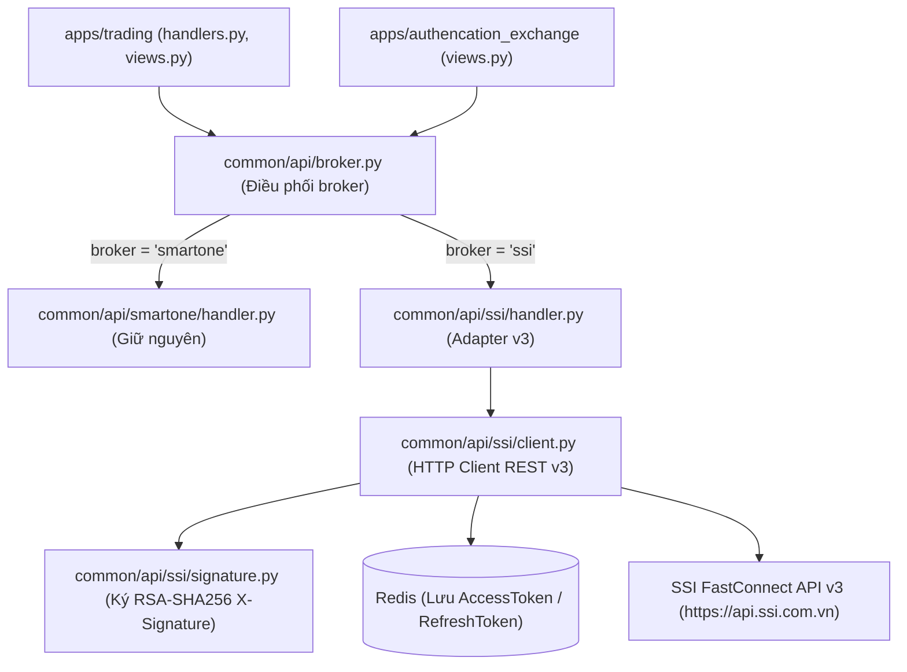

# Kế hoạch chuyển đổi SmartOne → SSI FastConnect

> Cập nhật: **16/11/2026** · Trạng thái: **Đã nâng cấp 100% sang FastConnect API v3, sẵn sàng chạy kiểm thử trên VPS**

## 1. Tổng quan nhanh

| Mục | Hiện tại (SmartOne) | Sau chuyển (SSI FastConnect API v3) |
|---|---|---|
| Cổng API | Web trading SmartOne | `https://api.ssi.com.vn` (FastConnect v3 REST & WebSocket) |
| Xác thực | Login web + OTP → `ASP.NET_SessionId` | `POST /api/v3/auth/token` (`apiKey`, `apiSecret`, `otp`) → JWT Token lưu Redis |
| Đặt/sửa/hủy lệnh | POST `core.vpbs` (`Web.newOrder`...) | REST `POST/PUT/DELETE /api/v3/trading/order` + **chữ ký RSA-SHA256 (`X-Signature`)** |
| Truy vấn | `Web.Order.FullAllOrder`, `Web.Portfolio.*` | `orderBook`, `accountBalance`, `ppmmrAccount`, `position` |
| Đơn vị giá | nghìn đồng (21.5) | đồng (21500) → tự quy đổi ở lớp SSI adapter |
| Mã lệnh | `orderNo`, `refId` | `orderId`, `clientRequestId` |

## 2. Kiến trúc FastConnect API v3 đã triển khai

**Nguyên tắc cốt lõi:** Handler SSI **giữ nguyên tên hàm, tham số, định dạng trả về** của SmartOne $\rightarrow$ Toàn bộ logic trading cốt lõi (hơn 3000 dòng trong `apps/trading`) được bảo toàn tuyệt đối, chỉ thay đổi luồng import adapter.

---

## 3. Nhật ký tiến độ công việc

### Ngày 12/11/2026 (Triển khai hạ tầng VPS):
- Đã tạo repo git `dev` branch: `https://github.com/haimao0711/Autobot_be_ssi.git`.
- Backup cơ sở dữ liệu PostgreSQL tại `/root/postgres_data_backup.tgz` (36MB).
- Clone code và dựng stack 8 containers tại `/var/www/AutoBotCk_Backend_Ssi`.
- Chạy migration `0014_account_broker_ssi_fields` thành công trên DB PostgreSQL.
- Đặt file Private Key RSA tại `/var/www/AutoBotCk_Backend_Ssi/secrets/ssi_private.pem`.

### Ngày 16/11/2026 (Bước ngoặt FastConnect API v3 & Hoàn thiện Code):
- **Phát hiện quan trọng:** Tài khoản tạo trên `developers.ssi.com.vn` sử dụng **FastConnect API v3** (`https://api.ssi.com.vn`). SDK v2 cũ (`ssi-fctrading`) gọi `fc-tradeapi.ssi.com.vn` bị lỗi `NameError: This connection is invalid`.
- Đã kiểm tra cURL trực tiếp trên VPS tới `/api/v3/auth/token` với `apiKey` và `apiSecret` thành công (HTTP 200).
- Thu thập và lưu trữ đầy đủ tài liệu API v3 (Auth, Trading REST, FCO, WebSocket, Query) vào [SSI_API_V3_DOCS.md](file:///e:/ANguyenBot/ssi_be_autobot/SSI_API_V3_DOCS.md).
- **Viết mới `common/api/ssi/signature.py`:** Ký RSA-SHA256 trên `SecretKey + JSON_Body` ra Base64 cho header `X-Signature`, đọc được cả XML `<RSAKeyValue>` và PEM.
- **Viết mới `common/api/ssi/client.py`:** Gọi REST API v3, quản lý `accessToken`/`refreshToken` trong Redis, tự động refresh token khi gặp 401.
- **Viết mới `common/api/ssi/handler.py`:** Chuẩn hóa toàn bộ các hàm đặt, sửa, hủy lệnh, lấy sổ lệnh, số dư, danh mục và session theo REST v3.
- **Cập nhật Unit Test (`common/api/ssi/tests.py`):** 7/7 test cases passed offline.
- **Commit & Push:** Đã đẩy commit `49e0c21` lên nhánh `dev` trên GitHub.

---

## 4. Bảng phân công & Checklist hiện tại

| # | Hạng mục | Trạng thái | Ghi chú |
|---|---|---|---|
| 1 | Cấu hình database migration (6 trường SSI) | ✅ Hoàn thành | Đã chạy migration 0014 trên VPS |
| 2 | Chữ ký số RSA-SHA256 XML/PEM (`signature.py`) | ✅ Hoàn thành | Đã test chuẩn PKCS1_v1_5 |
| 3 | Client REST API v3 + Redis cache (`client.py`) | ✅ Hoàn thành | Hỗ trợ OTP, refresh token, retry 401 |
| 4 | Handler Trading v3 tương thích SmartOne (`handler.py`) | ✅ Hoàn thành | Đặt/Sửa/Hủy/Sổ lệnh/Số dư/Vị thế |
| 5 | Bộ điều phối broker (`common/api/broker.py`) | ✅ Hoàn thành | Chuyển luồng theo `Account.broker` |
| 6 | Luồng xác thực OTP giao dịch (`views.py`) | ✅ Hoàn thành | Request OTP & Verify OTP vào Redis |
| 7 | Unit Test offline (`tests.py`) | ✅ Hoàn thành | 7/7 tests passed |
| 8 | Push code lên GitHub repo nhánh `dev` | ✅ Hoàn thành | Commit `49e0c21` |
| 9 | `git pull` & restart container trên VPS | ⏳ Sẵn sàng | Xem hướng dẫn bên dưới |
| 10 | `UPDATE account` bật broker SSI cho 1 tài khoản | ⏳ Sẵn sàng | Chạy SQL trên VPS |
| 11 | Đăng nhập OTP và test thử 1 lệnh 100 cp | ⏳ Sẵn sàng | Thử nghiệm thực tế |

---

## 5. Hướng dẫn tiếp tục công việc

Xem chi tiết từng bước thao tác dòng lệnh trong tài liệu [SSI_DEPLOY_GUIDE.md](file:///e:/ANguyenBot/ssi_be_autobot/SSI_DEPLOY_GUIDE.md).
