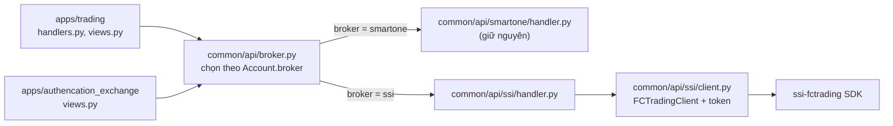

# Kế hoạch chuyển đổi SmartOne → SSI FastConnect

> Cập nhật: 2026-11-11 · Trạng thái chung: **Đã code xong lớp SSI, chờ test với tài khoản thật**

## 1. Tổng quan nhanh

| Mục | Hiện tại (SmartOne) | Sau chuyển (SSI) |
|---|---|---|
| Xác thực | Login web + OTP → `ASP.NET_SessionId` | `ConsumerID/Secret` → token đọc; **PIN/OTP → token ghi** |
| Đặt/sửa/hủy lệnh | POST `core.vpbs` (`Web.newOrder`...) | SDK `ssi-fctrading`: `NewOrder/ModifyOrder/CancelOrder` + chữ ký RSA |
| Truy vấn | `Web.Order.FullAllOrder`, `Web.Portfolio.*` | `orderBook`, `orderHistory`, `cashAcctBal`, `stockPosition` |
| Đơn vị giá | nghìn đồng (21.5) | đồng (21500) → tự quy đổi ở lớp SSI |
| Mã lệnh | `orderNo`, `refId` | `orderID`, `requestID` |

## 2. Kiến trúc đã triển khai

Nguyên tắc: handler SSI **giữ nguyên tên hàm, tham số, định dạng trả về** của SmartOne → logic trading (hơn 3000 dòng) không phải sửa, chỉ đổi dòng import.

## 3. Tiến độ

| # | Hạng mục | Trạng thái | File |
|---|---|---|---|
| 1 | Cài SDK, thêm vào requirements | ✅ Xong | `requirements.txt` |
| 2 | Trường cấu hình SSI trên `Account` + migration | ✅ Xong (chưa chạy migrate) | `apps/account/detail/models.py`, `migrations/0014_*` |
| 3 | Client SSI: token đọc, token ghi (PIN/OTP), cache Redis | ✅ Xong | `common/api/ssi/client.py` |
| 4 | Handler SSI: mua, bán, sửa, hủy, sổ lệnh, số dư, danh mục, `validate_session` | ✅ Xong | `common/api/ssi/handler.py` |
| 5 | Bộ điều phối broker theo từng tài khoản | ✅ Xong | `common/api/broker.py` |
| 6 | Đổi import trong trading/auth | ✅ Xong | `apps/trading/*`, `apps/authencation_exchange/views.py` |
| 7 | Luồng đăng nhập SSI (PIN/OTP) | ✅ Xong | `authencation_exchange/views.py` |
| 8 | Test offline với client giả | ✅ 6/6 đạt | `common/api/ssi/tests.py` |
| 9 | Chạy migration, nhập cấu hình SSI cho tài khoản | ⏳ Bạn thực hiện | — |
| 10 | Test thật: đối chiếu tên trường response SSI | ⏳ Cần bạn | xem mục 5 |
| 11 | Thông báo đăng nhập hiển thị "SSI" theo broker | ✅ Xong | `authencation_exchange/views.py` |
| 11b | Chống đặt trùng lệnh khi lỗi mạng (tra sổ lệnh theo `requestID`) | ✅ Xong | `common/api/ssi/handler.py` |
| 12 | Gỡ code SmartOne sau khi ổn định | ⏳ Sau cùng | — |

## 4. Các bước bạn cần làm để chạy thử

1. `pip install -r requirements.txt` (hoặc `pip install ssi-fctrading==2.5.3`).
2. `python manage.py migrate account`.
3. Lưu file private key RSA (đã tạo khi đăng ký FastConnect) trên server, **không** đưa vào git.
4. Cập nhật 1 tài khoản (admin/DB):

| Trường | Giá trị |
|---|---|
| `broker` | `ssi` |
| `account_num` | số tài khoản giao dịch SSI |
| `ssi_consumer_id`, `ssi_consumer_secret` | lấy từ iBoard |
| `ssi_private_key_path` | đường dẫn file private key |
| `ssi_two_fa_type` | `0` = PIN, `1` = OTP |
| `ssi_pin` | PIN (chỉ khi type = 0) |

5. Gọi API đăng nhập hiện có (`AuthencationStockExchagesView`): với OTP lần đầu sẽ gửi OTP, gọi lại kèm `otp` để lấy token ghi.
6. Thử **1 lệnh 100 cổ phiếu**: mua → sửa giá → hủy; so với iBoard.

## 5. Điểm cần đối chiếu khi test thật

> [!WARNING]
> Chưa có response thật của SSI nên các điểm dưới đây dựa trên tài liệu/SDK và cần xác nhận.

| Vấn đề | Cách xử lý hiện tại | Việc cần kiểm tra |
|---|---|---|
| Tên trường `cashAcctBal`, `stockPosition` | Đọc nhiều tên khả dĩ (`_first(...)`), đánh dấu `TODO` | In response thật rồi chốt tên trường |
| Trạng thái lệnh (`orderStatus`) | Lệnh chờ = không thuộc `FF, CL, RJ, EX` | Đối chiếu bảng mã trạng thái |
| Giá trần/sàn | SSI không trả → dùng trần rất lớn để không chặn nhầm | Nếu cần chặn giá, lấy từ nguồn giá |
| Bước giá | Làm tròn theo HOSE (10/50/100đ) | HNX/UPCOM bước 100đ → cần map theo sàn |
| `orderID` sau khi sửa lệnh | Lấy từ response, mặc định giữ mã cũ | Xác nhận SSI có đổi `orderID` |
| `newOrder` có trả `orderID` ngay không | Nếu không, tra `orderBook` theo `requestID` | Xác nhận độ trễ |
| `lỗi bước giá` (`-8029` của SmartOne) | SSI chưa có retry riêng | Xem mã lỗi SSI để thêm retry |
| Rate limit | Chưa có throttle | Xem `get_ratelimit`, thêm backoff nếu cần |

## 6. Rủi ro & lưu ý bảo mật

| Rủi ro | Biện pháp |
|---|---|
| Lộ `consumer_secret`/PIN | Hiện lưu trong DB (plaintext) → nên mã hóa hoặc đưa vào secret manager |
| Private key | Chỉ lưu đường dẫn; phân quyền file; không commit |
| OTP hết hạn giữa phiên | Token ghi lưu cache Redis; hết hạn thì validate trả `False` → bot dừng, cần đăng nhập lại |
| Đặt trùng lệnh khi retry | `requestID` mới mỗi lần; **cần kiểm tra orderBook trước khi retry** (chưa làm) |
| Chạy song song 2 broker | Chọn theo `Account.broker`, tài khoản cũ mặc định `smartone` nên không bị ảnh hưởng |

## 7. Lộ trình triển khai

| Giai đoạn | Nội dung | Điều kiện qua |
|---|---|---|
| A. Test thật | 1 tài khoản, lệnh 100 cp, mua/sửa/hủy | Dữ liệu khớp iBoard |
| B. Chốt response | Sửa các `TODO` mục 5 | Số dư, danh mục chính xác |
| C. Chạy bot | Bật bot với volume nhỏ 1–2 phiên | Không lỗi, không lệnh treo |
| D. Mở rộng | Chuyển các tài khoản còn lại | Ổn định ≥ 1–2 tuần |
| E. Dọn dẹp | Gỡ SmartOne, cột `vps_*` | Đã chuyển hết |

## 8. Cách quay lại SmartOne

Đặt `broker = 'smartone'` trên tài khoản đó, không cần deploy lại code.

## 9. Ghi chú bàn giao (11/11/2026)

**Đã xong:** toàn bộ lớp SSI (client, handler, điều phối broker, đăng nhập PIN/OTP, chống đặt trùng, test offline 6/6). Migration `0014` đã viết nhưng **chưa chạy**.

**Việc làm tiếp (theo thứ tự):**
1. Chạy `pip install -r requirements.txt` và `python manage.py migrate account`.
2. Nhập cấu hình SSI cho 1 tài khoản (mục 4), đăng nhập qua API xác thực.
3. In response thật của `cashAcctBal`, `stockPosition`, `orderBook` rồi gửi cho Antigravity để chốt các `TODO` trong `common/api/ssi/handler.py` và `constants.py` (tên trường, mã `orderStatus`).
4. Test 1 lệnh 100 cp: mua, sửa, hủy, so với iBoard.
5. Sau đó cân nhắc: retry riêng cho lỗi bước giá, throttle theo rate limit, mã hóa `consumer_secret`/PIN, bước giá HNX/UPCOM.

**Câu hỏi còn mở:** dùng PIN hay OTP (`ssi_two_fa_type`)? Có cần stream trạng thái lệnh realtime thay vì polling không?

**File chính:** `common/api/ssi/{client,handler,constants,tests}.py`, `common/api/broker.py`, `apps/account/detail/models.py`, `apps/authencation_exchange/views.py`.
